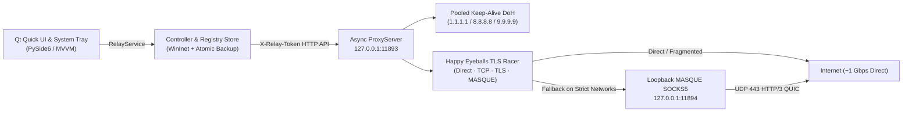

# Relay

[](https://www.python.org/)
[](https://doc.qt.io/qtforpython-6/)
[](#)
[](#)
[](LICENSE)

**Relay** is a high-throughput, driver-free Windows desktop **HTTPS / WSS / HTTP proxy controller** built with Python `asyncio` and **PySide6 (Qt Quick)**. It combines a zero-copy 1 Gbps+ transport bridge, a pooled Keep-Alive **DNS-over-HTTPS (DoH)** resolver, and a **Happy Eyeballs** adaptive TLS transport engine with automatic loopback **MASQUE (HTTP/3 QUIC)** fallback — all without kernel drivers, virtual network adapters, or administrator privileges.

---

## Why Relay?

Most network resilience tools require kernel packet-filtering drivers (`WinDivert`) or system-wide virtual TUN adapters that can conflict with antivirus software, game anti-cheats, or throttle normal internet traffic.

Relay takes a **pure user-space, hybrid approach**:

- **Zero-Driver & No Admin Required:** Runs entirely in user-space without modifying OS network adapters or installing kernel drivers.
- **Zero-Copy 1 Gbps+ Throughput:** Uses a custom `asyncio.Protocol` (`PipeProtocol`) with 4 MB OS socket buffers and `TCP_NODELAY` to bridge transports directly without `StreamReader` buffer copies.
- **Unblocked Traffic Stays Direct:** Normal browsing and downloads bypass the tunnel completely and use local system DNS to preserve nearby CDN edge latency.
- **Automatic Adaptation Across Networks:** Races direct TLS, TCP segment splitting, TLS record splitting, and an optional loopback **MASQUE (UDP 443 QUIC)** fallback. Automatically detects Wi-Fi/IP changes and system wake-from-sleep to flush stale per-network decisions.
- **Crash & Reboot Safe:** Atomically backs up `HKCU\...\Internet Settings` before enabling proxy settings and cleanly restores them on exit, logoff, or shutdown.

---

## Architecture



### Codebase Layout

```text
src/relay/
├── core/
│   ├── config.py        # Typed profiles, domain sanitization, atomic JSON persistence
│   ├── pac.py           # Lightweight PAC script generator (RFC1918 & localhost bypass)
│   └── telemetry.py     # Real-time throughput sampler & ring-buffered activity feed
├── proxy/
│   ├── server.py        # Async HTTP/HTTPS/WSS proxy + authenticated local control API
│   ├── dpi.py           # ClientHello parser, TCP/TLS fragmentation, Happy Eyeballs racer
│   ├── doh.py           # Direct-IP Keep-Alive DoH pool with TTL cache & circuit breaker
│   ├── pipe.py          # Zero-copy PipeProtocol transport bridge & socket tuning
│   └── tunnel.py        # Pure-stdlib RFC 1928 SOCKS5 client & managed MASQUE subprocess
├── platform/
│   ├── registry.py      # Windows HKCU Internet Settings store + WinInet broadcast
│   ├── worker.py        # Background proxy worker lifecycle & live hot-reload client
│   ├── diagnostics.py   # Parallel endpoint reachability & latency diagnostics
│   └── startup.py       # Optional Windows startup registration
├── service/
│   └── controller.py    # Thread-safe RelayService orchestrator (DI-friendly)
└── ui/
    ├── app.py           # HiDPI bootstrapper, single-instance mutex & QLocalServer IPC
    ├── viewmodel.py     # Qt Property/Slot MVVM ViewModel with async worker dispatch
    ├── tray.py          # Low-memory system tray mode (tears down QML scene when hidden)
    └── qml/             # Modular Warm Ceramic Qt Quick views & theme tokens
```

---

## How the Connection Pipeline Works

1. **Smart DNS Resolution:** Regular hosts resolve via OS DNS for optimal local CDN routing. Hosts requiring DoH (or failing direct connect) switch to a pooled Keep-Alive HTTPS connection directly to `1.1.1.1` / `8.8.8.8` / `9.9.9.9` with in-flight query deduplication.
2. **Happy Eyeballs Strategy Racing:**
   - Starts direct TLS immediately; if no valid `ServerHello` (`0x16`) arrives within `race_delay`, launches TCP segment fragmentation and TLS record fragmentation in parallel.
   - Rejects spoofed TLS Alerts (`0x15`) or non-handshake block responses.
   - On restrictive networks where fragmentation alone times out or resets, launches the loopback **MASQUE SOCKS5** fallback in parallel after `0.9s`, caches the winning route in memory per root domain, and cancels all losing sockets.
3. **Zero-Copy Streaming:** Once the handshake succeeds, both transports are handed off to `PipeProtocol` for direct kernel-to-kernel forwarding with backpressure (`pause_reading` / `resume_reading`).
4. **Network Roaming Monitor:** Periodically checks the active outbound interface IP and monotonic/wall-clock drift (sleep/wake). On network change, in-memory tunnel decisions are flushed so switching back to a fast home connection immediately resumes direct 1 Gbps routing.

---

## Network Profiles

| Profile | UI Label | Description |
|---|---|---|
| `auto` | **Oto** (`Otomatik`) | Default smart profile. Uses direct/fragmented connections on normal networks and automatically falls back to MASQUE only when needed. |
| `strict` | **Tünel** (`Tünel Öncelikli`) | Routes selected domains immediately through the loopback MASQUE tunnel while keeping normal browsing direct. |
| `fast` | **TCP** (`TCP Parçalama`) | Low-latency TCP `ClientHello` splitting with minimal delay. |
| `compat` | **TLS** (`TLS Parçalama`) | Prefers TLS record-level splitting for middleboxes that reassemble TCP segments. |

---

## Security & Privacy Design

- **Strict Loopback Binding:** Both the Relay proxy (`127.0.0.1:11893`) and the optional MASQUE SOCKS5 bridge (`127.0.0.1:11894`) bind exclusively to `localhost` — never exposed to the LAN (`0.0.0.0`).
- **Authenticated Control Plane:** Local management endpoints (`POST /config`, `/flush`, `/shutdown`) reject browser-originated requests (`Origin` / `Sec-Fetch-Site`) and require a per-install random `X-Relay-Token` validated with `hmac.compare_digest`.
- **Isolated User State:** Runtime credentials (`usque-config.json`, `control.token`) and settings live strictly under `%LOCALAPPDATA%\Relay\` and are never packaged into builds or committed to source control.

---

## Development & Build

### Prerequisites
- Windows 10 / 11
- Python 3.12+
- `PySide6`, `Pillow`, `pytest` (and `PyInstaller` for single-file builds)

### Run & Test

```powershell
# Run the test suite (unit + end-to-end async proxy & SOCKS5 fallback tests)
pytest -v

# Launch the desktop app from source
python -m relay
```

### Build Standalone `Relay.exe`

```powershell
# Optional: place usque.exe in ./bin/usque.exe to bundle the MASQUE fallback inside Relay.exe
python scripts/build.py
```

The standalone executable is written to `dist/Relay.exe` (and copied to the Desktop unless `--dist-only` is passed). On first launch on any Windows machine, Relay automatically extracts the bundled fallback binary into `%LOCALAPPDATA%\Relay\bin\` and initializes a fresh per-user configuration.

---

## Third-Party Acknowledgments

- Optional user-space MASQUE (HTTP/3 QUIC) SOCKS5 fallback powered by [Diniboy1123/usque](https://github.com/Diniboy1123/usque) (MIT License).

## License

Released under the [MIT License](LICENSE).
