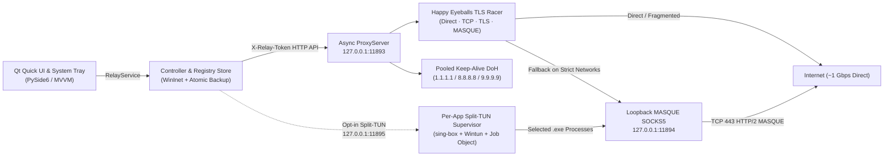

# Relay

[](https://www.python.org/)
[](https://doc.qt.io/qtforpython-6/)
[](#)
[](#)
[](LICENSE)

**Relay** is a high-throughput Windows desktop **adaptive local proxy & per-app split-tunnel controller** built with Python `asyncio` and **PySide6 (Qt Quick)**. It combines a zero-copy 1 Gbps+ transport bridge, a pooled Keep-Alive **DNS-over-HTTPS (DoH)** resolver, a **Happy Eyeballs** adaptive TLS transport engine with loopback **MASQUE (HTTP/2 over TCP 443)** fallback, and an opt-in **per-process Split-TUN** mode for desktop apps and games that ignore Windows system proxy settings.

---

## Why Relay?

System-wide VPNs and permanent kernel packet-filtering drivers often throttle gigabit connections, break local/Electron developer tools, or leave orphaned network state behind when closed.

Relay takes a **hybrid, user-space-first approach**:

- **User-Space by Default (No Admin Required):** Normal web and app traffic runs entirely in user-space with zero kernel drivers and zero virtual network adapters.
- **Zero-Copy 1 Gbps+ Throughput:** Uses a custom `asyncio.Protocol` (`PipeProtocol`) with 4 MB OS socket buffers and `TCP_NODELAY` to bridge transports directly without `StreamReader` buffer copies.
- **Normal Traffic Stays Direct:** Regular browsing, downloads, and live media streams stay on direct connections and OS DNS to preserve nearby CDN edge latency and prevent IP-bound stream errors.
- **Automatic Adaptation Across Networks:** Races direct TLS, TCP segment splitting, TLS record splitting, and an optional loopback **MASQUE (HTTP/2 over TCP 443)** fallback. Automatically detects Wi-Fi/IP changes and system wake-from-sleep to flush stale per-network routing decisions.
- **Opt-in Per-App Split-TUN (Game / App Mode):** For native desktop applications that ignore WinINET proxy settings, users can enable an on-demand per-process TUN route (`sing-box` + `Wintun`) via a native `.exe` file picker or 1-click running-window scanner. Protected by a Windows **Job Object (`KILL_ON_JOB_CLOSE`)**, authenticated loopback stop API, and parent-PID watchdog so the virtual adapter is always torn down cleanly.
- **Loopback & Electron-Safe:** Explicit `ProxyOverride` rules (`localhost`, `127.0.0.1`, `[::1]`, RFC1918) plus a proxy-level loopback fast-path keep local dev servers and Electron apps isolated from proxy/DoH overhead.
- **Crash & Reboot Safe:** Atomically backs up `HKCU\...\Internet Settings` before applying proxy settings and cleanly restores them on disconnect, exit, logoff, or shutdown.

---

## Architecture



### Codebase Layout

```text
src/relay/
├── core/
│   ├── config.py        # Typed profiles, domain & process sanitization, atomic JSON persistence
│   ├── pac.py           # Zero-DNS PAC script generator (RFC1918 & localhost bypass)
│   └── telemetry.py     # Real-time throughput sampler & ring-buffered activity feed
├── proxy/
│   ├── server.py        # Async HTTP/HTTPS/WSS proxy, loopback fast-path & authenticated control API
│   ├── dpi.py           # ClientHello parser, TCP/TLS fragmentation, Happy Eyeballs racer
│   ├── doh.py           # Direct-IP Keep-Alive DoH pool with TTL cache & circuit breaker
│   ├── pipe.py          # Zero-copy PipeProtocol transport bridge, socket tuning & stall detection
│   ├── tunnel.py        # Pure-stdlib RFC 1928 SOCKS5 client & managed MASQUE subprocess
│   └── gametunnel.py    # Opt-in per-app Split-TUN supervisor (sing-box + Wintun + Windows Job Object)
├── platform/
│   ├── registry.py      # Windows HKCU Internet Settings store + WinInet broadcast
│   ├── worker.py        # Background proxy worker lifecycle & live hot-reload client
│   ├── diagnostics.py   # Parallel endpoint reachability & latency diagnostics
│   └── startup.py       # Optional Windows startup registration
├── service/
│   └── controller.py    # Thread-safe RelayService orchestrator (DI-friendly)
└── ui/
    ├── app.py           # HiDPI bootstrapper, single-instance mutex & QLocalServer IPC
    ├── viewmodel.py     # Qt Property/Slot MVVM ViewModel, .exe picker & running-window scanner
    ├── tray.py          # Low-memory system tray mode (tears down QML scene when hidden)
    └── qml/             # Modular Warm Ceramic Qt Quick views & theme tokens
```

---

## How the Connection Pipeline Works

1. **Loopback Fast-Path & Smart DNS:** `localhost` / `127.0.0.1` / `::1` connections bypass DoH, fragmentation, and tunneling completely. Regular hosts resolve via OS DNS for optimal local CDN routing; hosts that require DoH switch to a pooled Keep-Alive HTTPS connection directly to `1.1.1.1` / `8.8.8.8` / `9.9.9.9` with in-flight query deduplication.
2. **Happy Eyeballs Strategy Racing:**
   - Starts direct TLS immediately; if no valid `ServerHello` (`0x16`) arrives within `race_delay`, launches TCP segment fragmentation and TLS record fragmentation in parallel.
   - Rejects injected TLS Alerts (`0x15`) or invalid handshake responses.
   - On restrictive networks where fragmentation alone times out or resets, launches the loopback **MASQUE SOCKS5** fallback (`HTTP/2` over `TCP 443` with `10s` keep-alive) in parallel after `0.9s`, caches the winning route in memory per root domain, and cancels all losing sockets.
3. **Zero-Copy Streaming & Stall Protection:** Once the handshake succeeds, both transports are handed off to `PipeProtocol` for direct forwarding with backpressure (`pause_reading` / `resume_reading`). Post-handshake stall detection automatically recovers hung sockets while exempting strict direct domains (such as live video streams).
4. **Opt-in Per-App Split-TUN:** When enabled, only traffic from user-selected `.exe` processes is routed through the temporary Wintun interface into the local MASQUE SOCKS5 bridge; all other system traffic remains untouched. Toggling Game Mode off, disconnecting Relay, or exiting the parent process guarantees immediate teardown via Job Objects and a 1-second parent-PID watchdog.
5. **Network Roaming Monitor:** Periodically checks the active outbound interface IP and monotonic/wall-clock drift (sleep/wake). On network change, in-memory tunnel decisions are flushed and the MASQUE bridge auto-recovers so switching back to a fast home connection immediately resumes direct 1 Gbps routing.

---

## Network Profiles

| Profile | UI Label | Description |
|---|---|---|
| `auto` | **Oto** (`Otomatik`) | Default smart profile. Uses direct/fragmented connections on normal networks and automatically falls back to MASQUE only when needed. |
| `strict` | **Tünel** (`Tünel Öncelikli`) | Routes selected domains immediately through the loopback MASQUE tunnel while keeping normal browsing direct. |
| `fast` | **TCP** (`TCP Parçalama`) | Low-latency TCP `ClientHello` splitting with minimal delay. |
| `compat` | **TLS** (`TLS Parçalama`) | Prefers TLS record-level splitting for middleboxes that reassemble TCP segments. |

---

## Security & Process Lifecycle Design

- **Strict Loopback Binding:** The Relay proxy (`127.0.0.1:11893`), MASQUE SOCKS5 bridge (`127.0.0.1:11894`), and Split-TUN control endpoint (`127.0.0.1:11895`) bind exclusively to `localhost` — never exposed to the LAN (`0.0.0.0`).
- **Authenticated Control Plane:** Local management endpoints (`POST /config`, `/flush`, `/shutdown`, `/stop`) reject browser-originated requests (`Origin` / `Sec-Fetch-Site`) and require a per-install random `X-Relay-Token` validated with `hmac.compare_digest`.
- **Zero-Orphan Subprocess Management:** Elevated Split-TUN child processes are attached to a Windows Job Object with `JOB_OBJECT_LIMIT_KILL_ON_JOB_CLOSE` and monitored by a parent-PID watchdog, guaranteeing clean network adapter cleanup even after unexpected crashes.
- **Isolated User State:** Runtime credentials (`usque-config.json`, `control.token`) and settings live strictly under `%LOCALAPPDATA%\Relay\` and are never packaged into builds or committed to source control.

---

## Development & Build

### Prerequisites
- Windows 10 / 11
- Python 3.12+
- `PySide6`, `Pillow`, `pytest` (and `PyInstaller` for single-file builds)

### Run & Test

```powershell
# Run the test suite (30 unit + end-to-end async proxy, SOCKS5 & Split-TUN lifecycle tests)
pytest -v

# Launch the desktop app from source
python -m relay
```

### Build Standalone `Relay.exe`

```powershell
# Optional: place usque.exe, sing-box.exe, and wintun.dll in ./bin/ to bundle them inside Relay.exe
python scripts/build.py
```

The standalone executable is written to `dist/Relay.exe` (and copied to the Desktop unless `--dist-only` is passed). On first launch on any Windows machine, Relay automatically extracts bundled binaries into `%LOCALAPPDATA%\Relay\bin\` and initializes a fresh per-user configuration.

---

## Third-Party Acknowledgments

- Optional user-space MASQUE (`HTTP/2`) SOCKS5 fallback powered by [Diniboy1123/usque](https://github.com/Diniboy1123/usque) (MIT License).
- Optional per-app Split-TUN routing powered by [SagerNet/sing-box](https://github.com/SagerNet/sing-box) (GPL-3.0) and [Wintun](https://www.wintun.net/) (WireGuard LLC).

## License

Released under the [MIT License](LICENSE).
